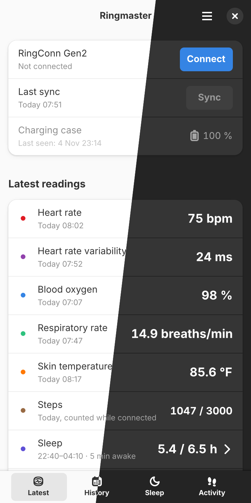
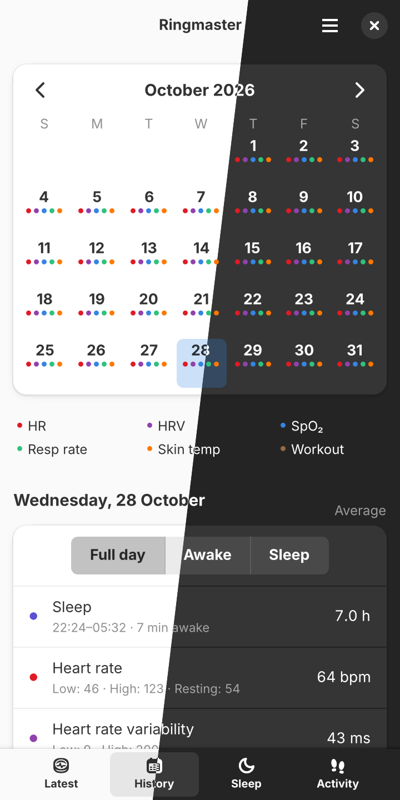
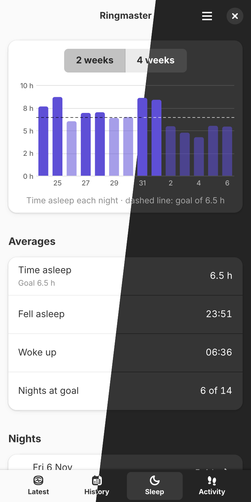
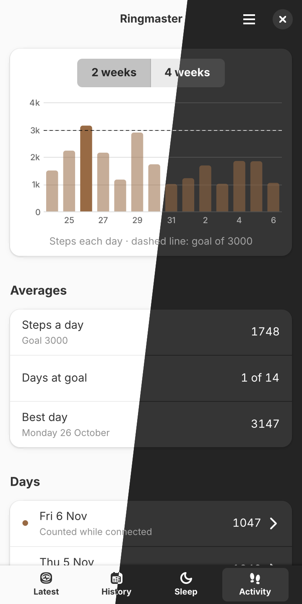

# Ringmaster

**Your smart ring, on your Linux phone. No cloud, no account.**

Ringmaster talks to your smart ring directly over Bluetooth and keeps everything it records in a
database on your own device. It is built for mobile Linux with GTK4 and libadwaita, and fits a
phone screen as well as a desktop window.

Tested on a RingConn Gen 2 (firmware FR02.018) with a FuriLabs FLX1s running FuriOS and Phosh.

<p align="center">
  
  
  
  
</p>

## What it does

**Latest**: the ring at a glance.

- Battery and charging state, and the charging case's battery when it was last seen
- Heart rate, heart rate variability, blood oxygen, respiratory rate and skin temperature, with
  when each was measured
- Steps today against your goal, and last night's sleep against your sleep goal
- A trend chart of any stream over the past hour, day or week
- A quick 30-second heart rate or blood oxygen reading whenever you want one
- Pull down to sync now

**History**: every day you have worn the ring.

- A month calendar marking what was recorded each day
- Each day's averages, lows and highs, split into the whole day, awake time or sleep
- A Sleep view for each night: time asleep less wakings, time below 90 % blood oxygen, and skin
  temperature against your usual
- Charts of every stream over any range of dates

**Sleep**: your nights over the past two or four weeks.

- Time asleep each night against your goal
- Average time asleep, when you usually fall asleep and wake up, and how many nights reached the
  goal
- Every night listed, opening in History

**Activity**: your steps over the past two or four weeks.

- Steps each day against your goal, the daily average, days at goal and your best day
- Every day listed, opening in History

**In the background**

- Syncs on opening and on a schedule (every 5, 15, 30, 60 or 90 minutes), and catches up when the
  phone wakes
- Keeps running with the window closed, starts at login if you like, and stays connected
- Notifications on rules you set: battery, case battery, skin temperature, heart rate, HRV, blood
  oxygen, respiratory rate, steps and days since the last sync
- More than one ring: add rings and switch between them, each with its own history

## Getting started

1. Install Ringmaster (below).
2. Take the ring out of its case so it advertises, and press **Connect** on the Latest tab. With
   several rings nearby, Ringmaster asks which is yours.
3. The first sync starts by itself. Later syncs follow the schedule in Preferences.

Already used the official RingConn Android app? Preferences → Rings → **Import from the RingConn
app** brings in everything it stored, from a copy of its `ring_conn.db`. The app keeps it in
`/data/data/com.gdjztech.ringconn/databases/`, reachable with root or a backup of the app's
private storage. Importing again adds only what is new.

**Only one app should sync a ring.** The ring deletes each page of history once an app has
collected it, and keeps about 7 days, so a ring left unsynced for over a week loses data. The
"Days since last sync" notification warns after 5 days.

## Rings

| Ring | Status |
|---|---|
| RingConn Gen 2 | Supported and tested |
| Colmi (R02 family) | Written from published protocol notes, not yet tried on a ring |
| RWfit rings (RWFit app) | Not supported: BlueZ drops their connection (`docs/bluez/`) |

## Install

Ringmaster can be installed from [AJHub](https://ajdunevent.github.io/AJHub/). Once you have
[added the AJHub remote](https://ajdunevent.github.io/AJHub/), install it with:

```sh
flatpak install ajhub net.dunevent.Ringmaster
```

To install it for your user only, add `--user` to this command; the AJHub remote then needs to
have been added with `--user` as well.

### Building it yourself

As a Flatpak:

```sh
flatpak run org.flatpak.Builder --user --install --install-deps-from=flathub --force-clean build build-aux/net.dunevent.Ringmaster.json
```

Or directly on the system:

```sh
sudo apt install build-essential pkg-config libdbus-1-dev libgtk-4-dev libadwaita-1-dev
cargo install --path crates/ringmaster
install -Dm644 data/net.dunevent.Ringmaster.desktop ~/.local/share/applications/net.dunevent.Ringmaster.desktop
install -Dm644 data/net.dunevent.Ringmaster.svg ~/.local/share/icons/hicolor/scalable/apps/net.dunevent.Ringmaster.svg
install -Dm644 data/net.dunevent.Ringmaster-symbolic.svg ~/.local/share/icons/hicolor/symbolic/apps/net.dunevent.Ringmaster-symbolic.svg
```

`cargo install` puts the binary in `~/.cargo/bin`, which needs to be on the `PATH` your session
starts with.

## Privacy

Everything stays on your device: readings in `~/.local/share/ringmaster/` (or
`~/.var/app/net.dunevent.Ringmaster/data/ringmaster/` under Flatpak), and nothing is sent anywhere.

## Support the project

- [Liberapay](https://liberapay.com/ajdunevent/donate)
- [PayPal](https://paypal.me/ajdunevent)

Bugs and ideas: [issues](https://dev.dunevent.net/aj/Ringmaster/issues). Building, testing and the
protocol notes: `docs/DEVELOPMENT.md`.

## Credits

The RingConn protocol work rests on [OpenCircuit](https://github.com/perezjuanj/OpenCircuit),
[ringlink](https://github.com/zazaulola/ringlink) and
[Gadgetbridge PR #6508](https://codeberg.org/Freeyourgadget/Gadgetbridge/pulls/6508); the other
brands' notes on [Gadgetbridge](https://codeberg.org/Freeyourgadget/Gadgetbridge), tahnok's Colmi
research and [PulseLoop](https://github.com/saksham2001/PulseLoopiOS) (CC BY 4.0). Ringmaster
implements the protocols from their documented findings and copies none of their code.

Not affiliated with RingConn or any ring maker. Not a medical device. GPL-3.0-or-later.
